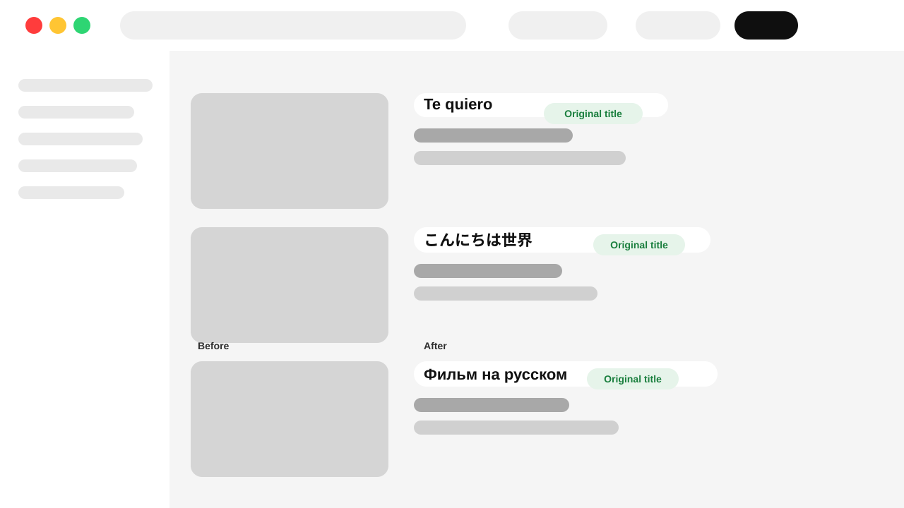

# OT-YT

**Zero Translation YouTube: keeps video titles in their original uploaded language.**

[](./LICENSE)
[](./manifest.json)
[](#overview--architecture)
[](https://github.com/M003aad/OT-YT/actions/workflows/ci.yml)

## Table of Contents

- [Overview / Architecture](#overview--architecture)
- [Features](#features)
- [Screenshots](#screenshots)
- [Codebase Breakdown](#codebase-breakdown)
- [Permissions](#permissions)
- [Installation & Setup](#installation--setup)
- [Usage](#usage)
- [Messaging & API Reference](#messaging--api-reference)
- [Scripts](#scripts)
- [Contributing](#contributing)
- [Security](#security)
- [License](#license)

## Overview / Architecture

OT-YT is a Chrome Manifest V3 extension that restores video titles to the language in which they were originally uploaded when YouTube supplies translated titles. It is implemented in vanilla JavaScript and has no bundler or application framework.

The manifest runs `interceptor.js` in the page's `MAIN` world at document start, allowing it to observe and patch YouTube data before the page renders it. The interceptor handles matching YouTube `fetch` and asynchronous XMLHttpRequest responses, as well as the initial `ytInitialData` and `ytInitialPlayerResponse` payloads. `content.js` runs in the isolated world and injects the interceptor as a fallback if the main-world script has not marked the page as active.

Original titles are looked up through YouTube's oEmbed endpoint. Resolved titles are cached in the YouTube page's `localStorage`, with concurrent lookups limited to six and the cache capped at 4,000 titles. The manifest targets Chrome on `www.youtube.com` and `m.youtube.com`; other browsers are not declared or tested by this project.

## Features

- Replaces translated titles in home and search results, recommendations, playlists, Shorts, and video pages when the corresponding renderer data is recognized.
- Patches YouTube `browse`, `next`, `player`, and `search` JSON API responses returned through `fetch` or asynchronous XMLHttpRequest.
- Handles titles embedded in YouTube's initial page data.
- Applies cached titles synchronously and limits parallel oEmbed lookups.
- Falls back to injecting the page interceptor from the isolated-world content script.

## Screenshots



The illustration shows original-language titles being restored in a YouTube-like interface after the extension rewrites translated metadata.

## Codebase Breakdown

```text
OT-YT/
├── .github/
│   ├── ISSUE_TEMPLATE/
│   ├── workflows/
│   └── PULL_REQUEST_TEMPLATE.md
├── assets/
│   └── ot-yt-screenshot.svg
├── icons/
│   ├── 16.16.png
│   ├── 32.32.png
│   ├── 48.48.png
│   └── 128.128.png
├── scripts/
│   └── validate-extension.js
├── .editorconfig
├── .gitattributes
├── .gitignore
├── .prettierrc
├── CITATION.cff
├── CODE_OF_CONDUCT.md
├── CONTRIBUTING.md
├── CHANGELOG.md
├── LICENSE
├── manifest.json
├── package.json
├── package-lock.json
├── README.md
├── SECURITY.md
├── SUPPORT.md
├── content.js
└── interceptor.js
```

| Path | Purpose |
| --- | --- |
| `manifest.json` | Declares the Manifest V3 extension, host access, icons, and content scripts. |
| `interceptor.js` | Patches YouTube page data, API responses, and title lookups in the main page world. |
| `content.js` | Injects the interceptor as an isolated-world fallback. |
| `assets/` | Project screenshots and visuals used in the documentation. |
| `icons/` | Extension icons referenced by the manifest. |
| `scripts/validate-extension.js` | Validates the manifest and that its referenced extension files exist. |
| `package.json` / `package-lock.json` | Define and lock the lint and validation tooling. |
| `.github/workflows/` | Validate changes in CI and package tagged releases. |
| `LICENSE` | Project license text. |
| `Prompt.txt` | Workspace-provided project task instructions; not part of the extension runtime. |

## Permissions

The manifest does not request browser API permissions. It declares the following host permissions:

| Host permission | Why it is needed |
| --- | --- |
| `*://www.youtube.com/*` | Runs the title interceptor on YouTube pages and permits same-origin YouTube API and oEmbed requests. |
| `*://m.youtube.com/*` | Runs the title interceptor on YouTube mobile web pages. |

## Installation & Setup

1. Clone the repository:

   ```sh
   git clone https://github.com/M003aad/OT-YT.git
   cd OT-YT
   ```

2. Install the development dependencies:

   ```sh
   npm ci
   ```

3. Run linting and extension validation:

   ```sh
   npm run lint
   npm run validate
   ```

   No compilation or bundling step is required.

4. In Chrome, open `chrome://extensions/` and enable **Developer mode**.
5. Select **Load unpacked**, then choose the repository folder containing `manifest.json`.
6. Open or refresh a page on `www.youtube.com` or `m.youtube.com`.

After changing extension files, reload the extension from `chrome://extensions/` and refresh open YouTube tabs.

## Usage

Once loaded, the extension works automatically on supported YouTube hosts. Titles already in its local cache are replaced immediately; uncached titles may take a short time while the extension requests their originals. No popup, options page, or user configuration is included.

## Messaging & API Reference

OT-YT does not use extension runtime messaging or a backend. It requests original video metadata from YouTube's oEmbed endpoint:

| Endpoint | Direction | Request | Response used |
| --- | --- | --- | --- |
| `GET /oembed?format=json&url={encoded YouTube watch URL}` on the current YouTube origin | Extension page interceptor to YouTube | Query parameters `format=json` and `url=https://www.youtube.com/watch?v={videoId}` | JSON response; the extension reads the non-empty `title` string. |

## Scripts

| Script | Description |
| --- | --- |
| `npm run lint` | Lints the extension JavaScript with ESLint. |
| `npm run validate` | Checks the manifest and verifies that referenced extension assets exist. |

## Contributing

Bug reports, feature proposals, and pull requests are welcome. See [CONTRIBUTING.md](./CONTRIBUTING.md) for the development workflow and contribution standards.

## Security

Please report suspected vulnerabilities privately. See [SECURITY.md](./SECURITY.md) for supported versions and reporting instructions.

## License

OT-YT is distributed under the GNU Affero General Public License v3.0 (AGPL-3.0). See [LICENSE](./LICENSE) for the license terms. Maintained by [M003aad](https://github.com/M003aad).
